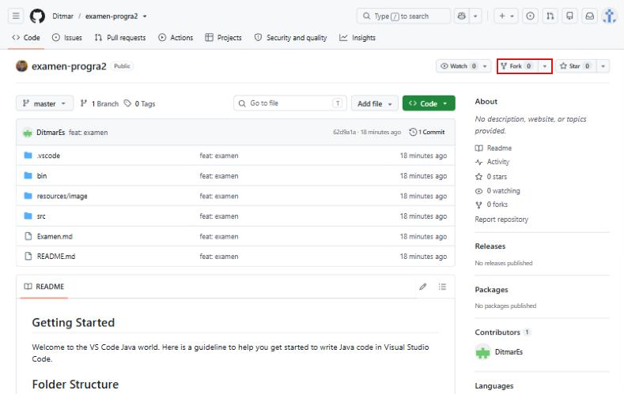
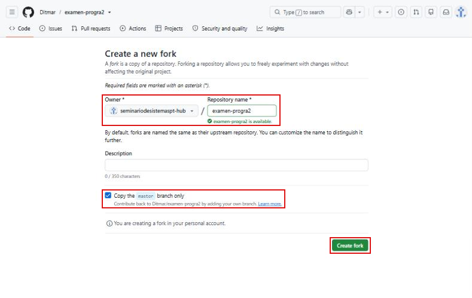
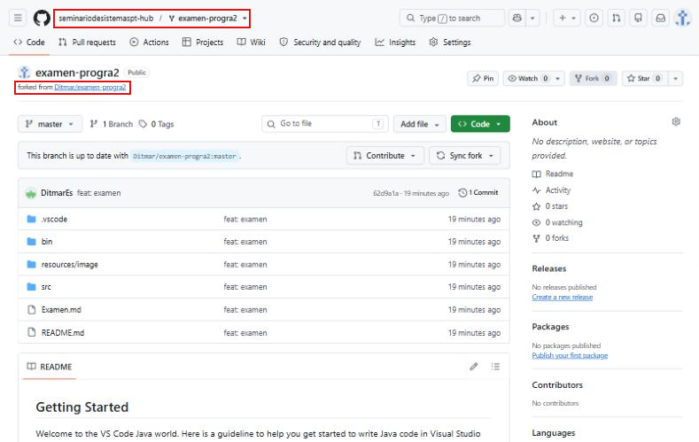
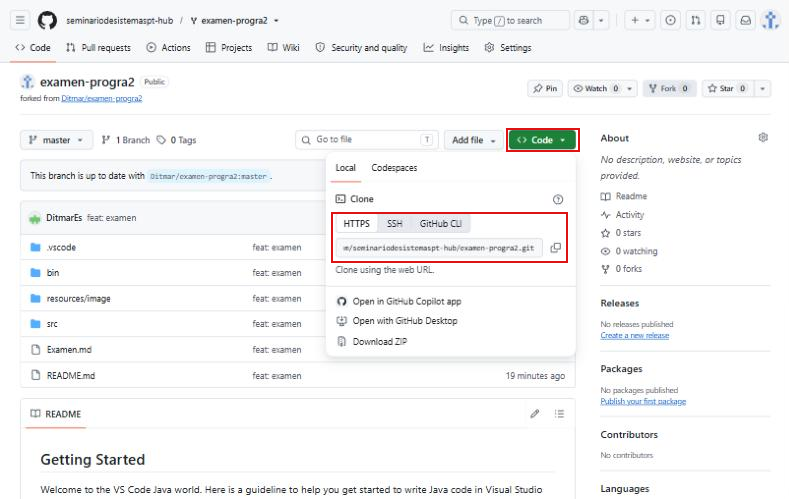
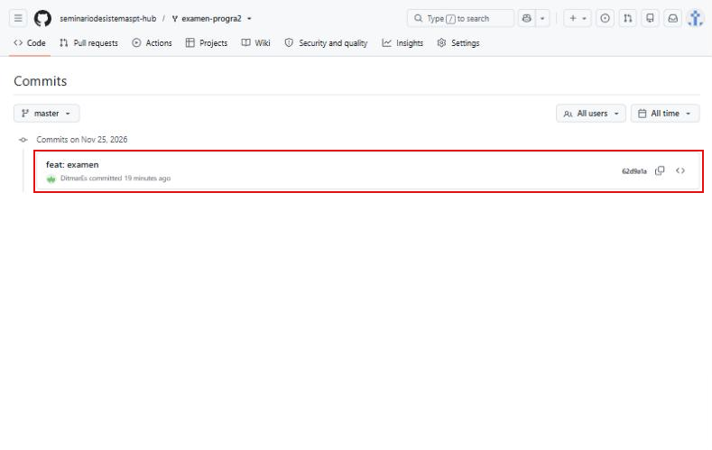

# Cómo entregar el examen

El examen se entrega con **GitHub**. Vas a crear tu propia copia del proyecto (un **fork**), trabajar en ella y enviar el enlace de tu copia.

Repositorio del examen: <https://github.com/Ditmar/examen-progra2>

## Antes de empezar

Necesitas:

- Una cuenta de GitHub. Si no tienes, créala gratis en <https://github.com/signup>.
- **Git** instalado. Compruébalo abriendo una terminal y escribiendo `git --version`. Si da error, descárgalo de <https://git-scm.com/downloads>.
- **VS Code** con la extensión **Extension Pack for Java**.

## Paso 1: Hacer el fork

Un fork es una copia del repositorio dentro de tu cuenta. Puedes modificarlo sin afectar el original.

1. Inicia sesión en GitHub.
2. Abre <https://github.com/Ditmar/examen-progra2>.
3. Arriba a la derecha, presiona el botón **Fork**.

   

4. En la pantalla **Create a new fork**:
   - En **Owner** debe aparecer tu usuario.
   - Deja el nombre del repositorio como está: `examen-progra2`.
   - Deja marcada la opción **Copy the `master` branch only**.
   - Presiona **Create fork**.

   

5. GitHub te lleva a tu copia. Fíjate en dos cosas:
   - La dirección ahora es `https://github.com/TU-USUARIO/examen-progra2`.
   - Debajo del nombre dice **forked from Ditmar/examen-progra2**.

   

> **Importante:** a partir de aquí trabaja **siempre en tu fork**, nunca en el repositorio del docente.

## Paso 2: Descargar (clonar) tu fork

1. En **tu fork**, presiona el botón verde **Code**.
2. En la pestaña **HTTPS**, copia la dirección. Debe terminar en `TU-USUARIO/examen-progra2.git`.

   

3. Abre una terminal en la carpeta donde quieras guardar el proyecto y ejecuta:

   ```bash
   git clone https://github.com/TU-USUARIO/examen-progra2.git
   ```

4. Abre la carpeta `examen-progra2` en VS Code (**File → Open Folder**).

> También puedes clonar desde VS Code: presiona `Ctrl+Shift+P`, escribe **Git: Clone** y pega la dirección.

## Paso 3: Ejecutar el proyecto

En VS Code, ve a **Run and Debug** (`Ctrl+Shift+D`), elige **App con recursos** y presiona ▶.

Debe abrirse la ventana de login. Al presionar **Login** se abre la ventana de notas. Si todo funciona, ya puedes resolver el [Examen](Examen.md).

## Paso 4: Guardar tu avance en GitHub

**Solo la primera vez**, configura tu nombre y tu correo:

```bash
git config --global user.name "Tu Nombre"
git config --global user.email "tu-correo@ejemplo.com"
```

Cada vez que termines una parte del examen, guarda y sube tus cambios:

```bash
git add .
git commit -m "Tarea 1: agregar notas"
git push
```

- Haz **un commit por cada tarea** como mínimo, con un mensaje que diga qué hiciste. El historial de commits forma parte de la evaluación.
- La primera vez que hagas `git push`, se abrirá una ventana para iniciar sesión en GitHub.

> Desde VS Code: en el panel **Source Control** (`Ctrl+Shift+G`), escribe el mensaje, presiona **Commit** y luego **Sync Changes**.

## Paso 5: Comprobar que se subió

Abre tu fork en el navegador y revisa:

- Que los archivos tengan tus cambios.
- Que tus commits aparezcan en el historial (el enlace **commits** arriba de la lista de archivos).



## Paso 6: Entregar

Envía el **enlace de tu fork** antes de la fecha límite, por el medio que indique el docente:

```
https://github.com/TU-USUARIO/examen-progra2
```

- **No** abras un *Pull Request* al repositorio del docente.
- Los commits hechos después de la fecha límite no se toman en cuenta.

## Problemas frecuentes

| Problema | Solución |
|---|---|
| El botón **Fork** no hace nada o está gris | No iniciaste sesión en GitHub. |
| `git push` da error **403** o **Permission denied** | Clonaste el repositorio del docente en lugar de tu fork. Corrígelo con `git remote set-url origin https://github.com/TU-USUARIO/examen-progra2.git` |
| `git` no se reconoce como comando | Instala Git y vuelve a abrir la terminal y VS Code. |
| `git commit` pide nombre y correo | Haz la configuración del Paso 4. |
| VS Code no encuentra **App con recursos** | Abriste una carpeta equivocada. Abre la carpeta `examen-progra2`, la que contiene `src`. |
